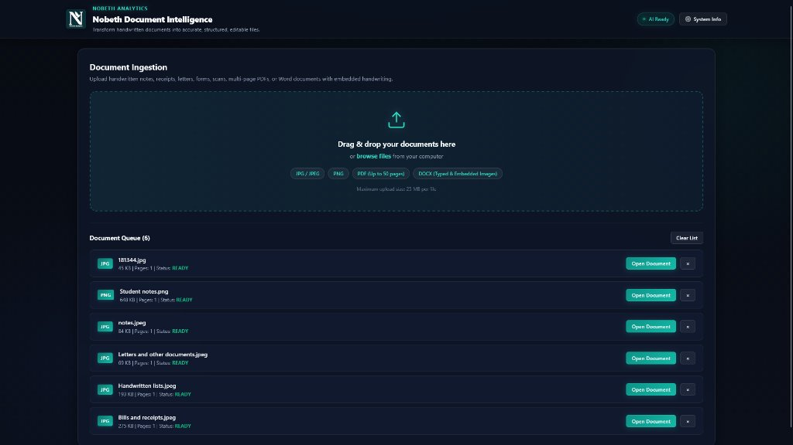
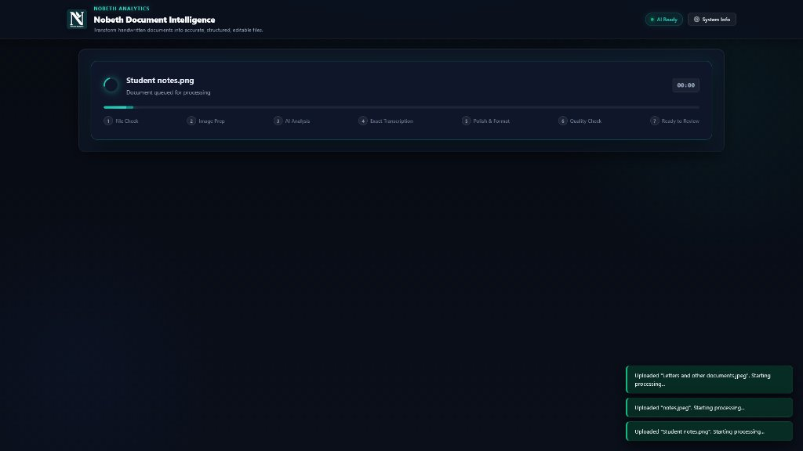
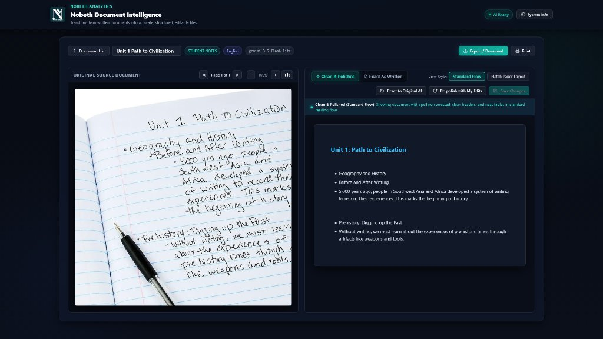
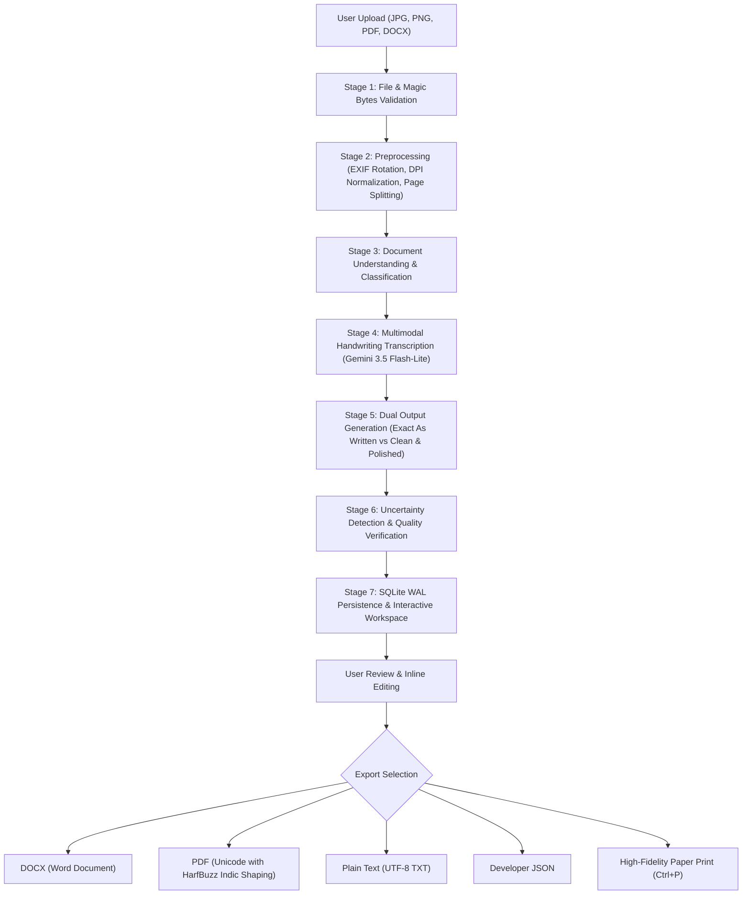

# Nobeth Document Intelligence
### Official Nobeth Analytics Product
**Category:** AI-Powered Handwritten and Digital Document Understanding Platform  
**Architecture:** Single-Server FastAPI + SQLite (WAL) + Multimodal Google Gemini + Vanilla Glassmorphism UI

---



---

## 1. Product Overview

**Nobeth Document Intelligence** is an enterprise-grade document intelligence platform developed by **Nobeth Analytics**. It transforms physical handwritten notebook pages, scanned business documents, receipts, personal letters, forms, and Word documents with embedded images into structured, editable, and professionally formatted digital documents.

The platform is designed with a **privacy-first, local-first architecture**:
* All uploaded files, rendered high-resolution preview pages, and SQLite databases remain strictly on the host server under private directories (`data/`).
* Multimodal AI document understanding is performed via Google's latest high-speed **`gemini-3.5-flash-lite`** model, with automated fallback resilience to **`gemini-3.1-flash-lite`**.
* The user interface features an **obsidian dark-mode glassmorphic design** built with zero heavyweight frontend frameworks, running seamlessly across all modern desktop and mobile browsers.

---

## 2. Visual Interface Showcase

### A. Document Ingestion & Live Queue
Upload photos, phone scans, multi-page PDFs (up to 50 pages), and DOCX files. The queue provides per-file status badges, page counters, and instant actions.


---

### B. 7-Stage Live Processing Timeline
Real-time animated progress bar showing the 7 stages of document understanding, with elapsed timer and recovery controls.



---

### C. Split-Screen Review & Digital Editor Workspace
Interactive side-by-side workspace: original handwritten page with interactive bounding boxes on the left, and full digital word-processor editor on the right.



---

## 3. End-to-End System Workflow



---

## 4. Key Features & Plain-English Controls

Designed for everyday users without confusing technical jargon:

| Feature / Button | Plain-English Label | Purpose & What It Does |
| :--- | :--- | :--- |
| **Cleaned Output** | **`Clean & Polished`** | Automatically corrects spelling and handwriting slips, fixes grammar, and formats headings, lists, and tables into clean digital blocks while strictly preserving all facts, numbers, and dates. |
| **Verbatim Output** | **`Exact As Written`** | Generates an exact word-for-word copy of the handwriting, preserving original spelling, slang, shorthand, crossed-out words, and punctuation. |
| **Professional Style** | **`Standard Flow`** | Reflows document into standard word-processor layout with clean headings and balanced margins. Recommended for reading, printing, and sharing. |
| **Layout Mode** | **`Match Paper Layout`** | Reconstructs physical spatial positioning to match where words and tables appeared on the physical notebook page or paper receipt. |
| **Regenerate** | **`Re-polish with My Edits`** | If you typed corrections in the document (such as fixing an unreadable name), clicking this re-runs AI polishing using your updated words. |
| **Restore** | **`Reset to Original AI`** | If you made typing mistakes, clicking this safely discards your edits and restores the initial AI transcription. |
| **Save** | **`Save Changes`** | Permanently saves manual corrections to the SQLite database. |

---

## 5. Multilingual & Complex Script Support

* **Automatic Language Detection:** Operates at the document, page, and block level without manual configuration.
* **Language Priorities:** English, Tamil (`தமிழ்`), Hindi (`हिन्दी`), and mixed scripts.
* **Zero Translation Guarantee:** The platform never translates your text—it preserves content in its original written language.
* **Complex Script HarfBuzz Shaping:** Exported PDFs embed Unicode TrueType fonts (`Nirmala UI`) with HarfBuzz complex-script shaping via `fpdf2` and `uharfbuzz` to eliminate broken Indic glyphs or question marks.

---

## 6. Project Architecture & Directory Structure

```text
Nobeth-Document-Intelligence/
├── .env.example                     # Environment configuration template
├── .gitignore                       # Git exclusion rules (safeguards secrets & temp files)
├── .python-version                  # Python runtime specification (3.11.7)
├── Procfile                         # Cloud process definition (for Render / Heroku)
├── render.yaml                      # Render Blueprint Infrastructure-as-Code
├── requirements.txt                 # Pinned application dependencies
├── run.bat                          # 1-Click Windows Local Launcher
├── README.md                        # Documentation & Visual Guide
│
├── app/
│   ├── __init__.py
│   ├── main.py                      # FastAPI application entrypoint, CORS, & lifespan
│   ├── config.py                    # Environment settings, safety limits, & paths
│   │
│   ├── api/
│   │   ├── __init__.py
│   │   └── routes.py                # REST API endpoints (Upload, Jobs, Edits, Exports)
│   │
│   ├── database/
│   │   ├── __init__.py
│   │   └── database.py              # Thread-safe SQLite WAL database & queries
│   │
│   ├── schemas/
│   │   ├── __init__.py
│   │   └── document.py              # Master Document Pydantic v2 data models
│   │
│   ├── services/
│   │   ├── __init__.py
│   │   ├── file_service.py          # Magic bytes validation & file signature checks
│   │   ├── image_service.py         # EXIF orientation, normalization, & DPI scaling
│   │   ├── pdf_service.py           # PyMuPDF multi-page rendering & text detection
│   │   ├── docx_service.py          # OOXML safe traversal & image extraction
│   │   ├── gemini_service.py        # Google Gen AI SDK (Gemini 3.5 & 3.1 fallback)
│   │   ├── document_service.py      # 10-stage processing pipeline coordinator
│   │   └── export_service.py        # Multi-format exports (DOCX, HarfBuzz PDF, TXT, JSON)
│   │
│   ├── static/
│   │   ├── css/
│   │   │   └── app.css              # Glassmorphic dark theme & motion flow stylesheet
│   │   ├── js/
│   │   │   └── app.js               # Reactive frontend application logic & drag-and-drop
│   │   └── assets/
│   │       ├── nobeth-analytics.png # Official Nobeth Analytics logo
│   │       └── fonts/               # Nirmala UI Unicode TrueType fonts (Regular & Bold)
│   │
│   └── templates/
│       └── index.html               # Single-page application HTML5 interface
│
├── docs/
│   └── screenshots/                 # Application screenshots for documentation
│
└── tests/                           # Pytest automated test suite (19 test cases)
    ├── test_api_endpoints.py
    ├── test_export_multilingual.py
    ├── test_file_service.py
    ├── test_gemini_fallback.py
    ├── test_image_pdf_docx.py
    └── test_schemas_and_db.py
```

---

## 7. Local Installation & Setup

### Prerequisites
* **Python:** 3.10, 3.11, or 3.12 (Python 3.11 recommended).
* **Google AI Studio API Key:** Get a free key from [Google AI Studio](https://aistudio.google.com/).

### Option A: Windows 1-Click Launch (Recommended)
Double-click `run.bat` in the project folder. It will:
1. Automatically detect or create a clean `.venv` virtual environment.
2. Install all required dependencies from `requirements.txt`.
3. Check and notify you about `.env` configuration.
4. Launch the application on `http://127.0.0.1:8000` and automatically open your default browser.

### Option B: Manual Setup (Windows, macOS, Linux)
```bash
# 1. Clone the repository
git clone https://github.com/sankaran-s2001/Nobeth-Document-Intelligence.git
cd Nobeth-Document-Intelligence

# 2. Create and activate a virtual environment
python -m venv .venv

# On Windows:
.venv\Scripts\activate
# On macOS / Linux:
source .venv/bin/activate

# 3. Install dependencies
pip install -r requirements.txt

# 4. Set up environment variables
cp .env.example .env
# Edit .env and paste your GEMINI_API_KEY

# 5. Run automated tests
pytest tests

# 6. Start the server
uvicorn app.main:app --host 127.0.0.1 --port 8000
```
Open **`http://127.0.0.1:8000`** in your browser.

---

## 8. Deployment on Render (Step-by-Step)

The project is pre-configured for cloud deployment on **Render** (as well as Railway, Fly.io, or any Docker/Linux host).

### Method 1: Deploy with Render Blueprint (Fastest)
1. Push your repository to GitHub.
2. Log in to [Render Dashboard](https://dashboard.render.com/).
3. Click **New +** $\to$ **Blueprint**.
4. Connect your GitHub repository: `sankaran-s2001/Nobeth-Document-Intelligence`.
5. Render will detect `render.yaml` automatically.
6. Enter your `GEMINI_API_KEY` under the prompted environment variable.
7. Click **Apply**. Render will build and deploy the web service.

---

### Method 2: Manual Web Service Creation on Render
1. Log in to your [Render Dashboard](https://dashboard.render.com/).
2. Click **New +** $\to$ **Web Service**.
3. Select **Build and deploy from a Git repository** and pick `sankaran-s2001/Nobeth-Document-Intelligence`.
4. Configure the settings:
   * **Name:** `nobeth-document-intelligence`
   * **Region:** Any region close to your users (e.g., Oregon, Frankfurt, Singapore).
   * **Branch:** `main` (or `master`)
   * **Runtime:** `Python`
   * **Build Command:**
     ```bash
     pip install -r requirements.txt
     ```
   * **Start Command:**
     ```bash
     uvicorn app.main:app --host 0.0.0.0 --port $PORT
     ```
5. Add the **Environment Variables**:
   | Key | Value | Notes |
   | :--- | :--- | :--- |
   | `PYTHON_VERSION` | `3.11.7` | Specifies runtime version |
   | `GEMINI_API_KEY` | `AIzaSy...` | Your Google AI Studio API key |
   | `GEMINI_PRIMARY_MODEL` | `gemini-3.5-flash-lite` | Primary extraction model |
   | `GEMINI_FALLBACK_MODEL` | `gemini-3.1-flash-lite` | Fallback resilience model |
   | `MAX_UPLOAD_MB` | `25` | Maximum upload size per file |
   | `MAX_PDF_PAGES` | `50` | Maximum pages per PDF |
   | `MAX_CONCURRENT_JOBS` | `2` | Bound concurrent AI jobs |
   | `JOB_RETENTION_HOURS` | `24` | Automated cleanup interval |
   | `OPEN_BROWSER` | `false` | Must be false in headless cloud |
6. Click **Deploy Web Service**.
7. Once deployment finishes, your app will be live at `https://nobeth-document-intelligence.onrender.com`!

---

## 9. Security & Application Governance

* **Decompression Bomb Protection:** Multi-megabyte ZIP payloads and embedded images in `.docx` and `.pdf` files are pre-screened to prevent ZIP bomb and quadratic expansion attacks.
* **Strict Signature Checks:** Every upload is checked using magic byte signatures (`FF D8 FF` for JPEG, `89 50 4E` for PNG, `%PDF` for PDF, `50 4B 03 04` for DOCX) rather than trusting client file extensions.
* **Path Traversal Immunization:** Files are assigned server-generated UUIDs and stored inside isolated subfolders with path resolution safeguards.
* **Ephemeral Job Retention:** Files and metadata automatically expire and are purged from disk after 24 hours.

---

## 10. License & Intellectual Property

Copyright &copy; 2026 **Nobeth Analytics**. All rights reserved.  
This software is proprietary and confidential to Nobeth Analytics.
